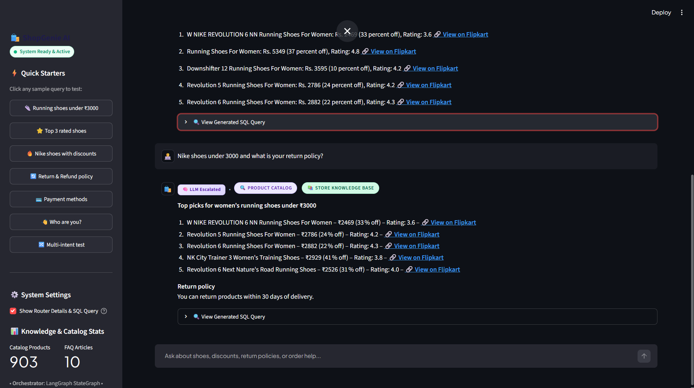
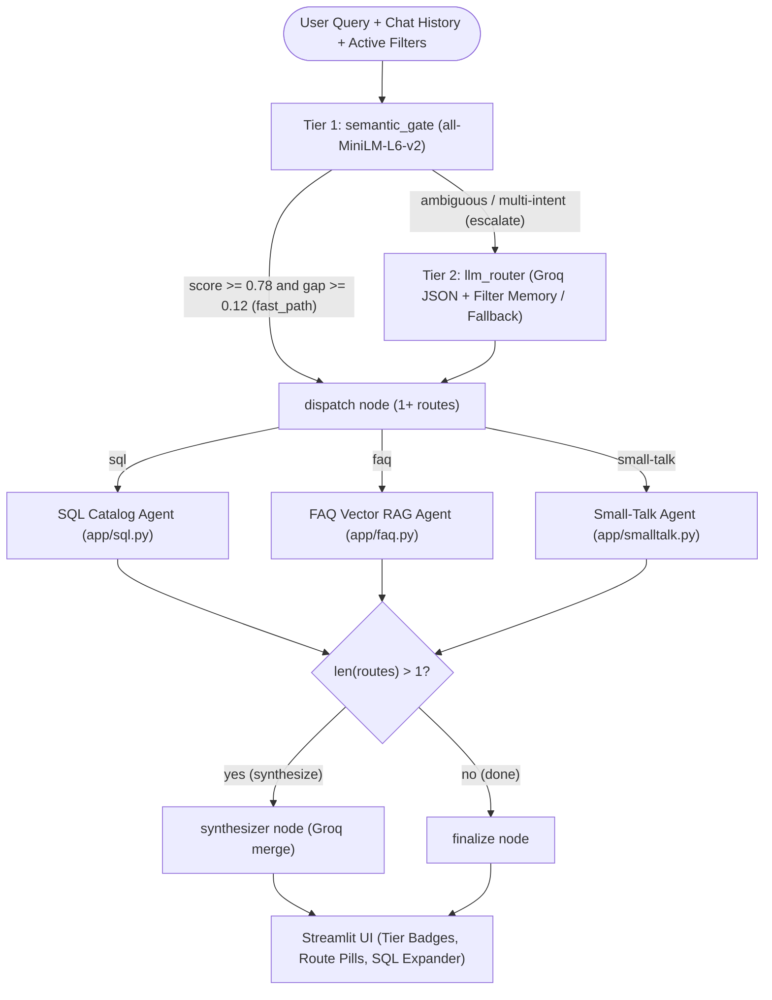

# 🛍️ ShopGenie — Intelligent E-Commerce AI Assistant

[](https://www.python.org/downloads/)
[](https://docs.astral.sh/uv/)
[](https://langchain-ai.github.io/langgraph/)
[](https://streamlit.io)
[](https://groq.com)
[](https://www.trychroma.com)
[](LICENSE)

An intelligent, multi-intent conversational AI shopping assistant designed for e-commerce footwear discovery and support. **ShopGenie** combines a **Semantic-First Tiered LangGraph Router**, **Conversational Filter Memory**, **Text-to-SQL catalog querying**, and **ChromaDB vector Retrieval-Augmented Generation (RAG)** inside a clean, transparent Streamlit interface.

---

## 📸 User Interface Preview

### Multi-Intent Tiered Routing & Sidebar Inspector


### Hero Overview & Single-Intent Chat View


---

## 🏗️ Architecture & How It Works

ShopGenie uses a **Semantic-First Tiered Router** (`app/graph.py`) that resolves clear single-intent queries locally in sub-50ms and escalates ambiguous, multi-intent, or follow-up queries to a Groq LLM router with persistent filter memory:



### Compiled LangGraph Workflow


---

## ✨ Key Features

- **⚡ Tier 1 Semantic Fast-Path (`semantic_gate_node`)**: Uses `sentence-transformers/all-MiniLM-L6-v2` cosine similarity against route anchor phrases. Queries with `top_score >= 0.78` and `(top_score - second_score) >= 0.12` bypass the LLM router completely.
- **🧠 Tier 2 LLM Multi-Intent Escalation (`llm_router_node`)**: Escalates ambiguous, multi-intent, or conversational follow-up queries to Groq (`response_format={"type": "json_object"}`), returning one or more routes (`sql`, `faq`, `small-talk`) with a `semantic_fallback` safety net if the API is unavailable.
- **🔀 Multi-Intent Synthesis (`synthesizer_node`)**: Handles combined requests (e.g., searching for shoes *and* asking about return policies in a single prompt) and merges agent outputs cohesively without duplicate greetings.
- **🧠 Conversational Filter Memory**: Tracks `active_filters` (`brand`, `max_price`, `min_rating`, `category`) across turns so follow-ups like *"Show cheaper ones"* or *"only Puma"* refine prior constraints automatically, with active filters visible and clearable in the sidebar.
- **🔍 Natural Language to SQL (`app/sql.py`)**: Translates catalog queries into safe SQLite `SELECT` queries across 903 footwear products with `LIMIT 5` and `response.head(5)` guardrails.
- **📚 FAQ Vector RAG (`app/faq.py`)**: Indexes store policies in ChromaDB (`faqs` collection) and answers returns, refunds, shipping, tracking, payments, and promo questions strictly from retrieved context.
- **🎨 Transparent Clean UI (`app/main.py`)**:
  - Tier & route badges (`⚡ Semantic Fast-Path (score)`, `🧠 LLM Escalated`, `🔄 Semantic Fallback` + `🔍 Product Catalog`, `📚 Store Knowledge Base`, `💬 Conversational`).
  - Collapsible `🔍 View Generated SQL Query` inspector drawer.
  - Automatic link formatting converting raw Flipkart URLs into `[🔗 View on Flipkart]` links.
  - Sidebar quick-starter prompts (including multi-intent test), active filter display, and catalog/FAQ metrics.

---

## 📂 Project Structure

```plaintext
Ecommerce_chatbot/
├── app/
│   ├── resources/
│   │   ├── architecture-diagram.png    # High-level system architecture graphic
│   │   ├── ecommerce_data_final.csv    # Raw product catalog dataset (Flipkart)
│   │   ├── faq_data.csv                # E-commerce store FAQs dataset (10 articles)
│   │   ├── graph.png                   # Compiled LangGraph StateGraph diagram
│   │   ├── image.png                   # Tiered router & multi-intent UI screenshot
│   │   └── shopgenie-ui.png            # Hero header & single-route chat screenshot
│   ├── .env                            # API keys & model configuration
│   ├── db.sqlite                       # SQLite database (product table: 903 items)
│   ├── faq.py                          # ChromaDB RAG vector ingestion & QA chain
│   ├── graph.py                        # Semantic-First Tiered Router & LangGraph workflow
│   ├── main.py                         # Streamlit UI application
│   ├── smalltalk.py                    # Conversational chatbot chain
│   └── sql.py                          # NL-to-SQL generator & data comprehension
├── .env.example                        # Sample environment variables
├── AGENTS.md                           # Multi-agent system architecture & incident log
├── pyproject.toml                      # uv project configuration & dependencies
├── README.md                           # Main project documentation
└── uv.lock                             # Locked uv dependency graph
```

---

## 🛠️ Tech Stack

| Component | Technology | Description |
|---|---|---|
| **Frontend UI** | [Streamlit](https://streamlit.io/) | Interactive web UI with tier/route badges & SQL inspector |
| **LLM Provider** | [Groq Cloud](https://groq.com/) | High-speed inference (`openai/gpt-oss-20b` default) |
| **Orchestration & Routing** | [LangGraph](https://langchain-ai.github.io/langgraph/) | Stateful `StateGraph` tiered router & multi-intent synthesis |
| **Package Manager** | [uv](https://docs.astral.sh/uv/) | Fast Python dependency & virtual environment management |
| **Embeddings** | [Sentence Transformers](https://sbert.net/) | `sentence-transformers/all-MiniLM-L6-v2` (Tier-1 gate & RAG) |
| **Vector DB** | [ChromaDB](https://www.trychroma.com/) | Embedding store for semantic FAQ search |
| **Relational DB** | [SQLite3](https://sqlite.org/) | 903 Flipkart footwear products |
| **Data Processing** | [Pandas](https://pandas.pydata.org/) | Data manipulation and query result formatting |

---

## 🚀 Getting Started

### 1. Prerequisites
- **[uv](https://docs.astral.sh/uv/)** installed on your system.
- **Python 3.10+** (see `pyproject.toml` for project configuration).
- A **Groq API Key** (get one free at [console.groq.com](https://console.groq.com)).

### 2. Clone the Repository
```bash
git clone <repository-url>
cd Ecommerce_chatbot
```

### 3. Install Dependencies with `uv`
```bash
uv sync
```

### 4. Configure Environment Variables
Create an `.env` file in the `app/` folder (or copy from `.env.example`):
```ini
GROQ_API_KEY=gsk_your_groq_api_key_here
GROQ_MODEL=openai/gpt-oss-20b
```

> **Tip:** You can also use other Groq-supported models such as `llama-3.3-70b-versatile`.

---

## 🖥️ Running the Application

Launch the Streamlit app from the project directory using `uv`:

```bash
uv run streamlit run app/main.py
```

The application will launch in your default browser at:
`http://localhost:8501`

---

## 💡 Example Queries to Try

### 🔀 Multi-Intent & Follow-Up Queries (Tier-2 LLM Escalated)
- *"Nike shoes under 3000 and what is your return policy?"*
- *"Running shoes under 3000 and can i return these when the shoe doesnt fit"*
- Follow-ups using Filter Memory: *"Show cheaper ones"*, *"only Puma"*

### 🔍 Product Searches (SQL Agent)
- *"Show me running shoes under Rs. 3000"*
- *"Find Nike shoes that have discount"*
- *"Show top 3 shoes with highest rating"*
- *"Show me Puma sneakers with rating above 4.2"*

### 📚 Store Policies & FAQs (RAG Agent — Fast-Path)
- *"What is the return policy of the products?"*
- *"Do I get discount with the HDFC credit card?"*
- *"How can I track my order?"*
- *"What payment methods are accepted?"*
- *"How long does it take to process a refund?"*

### 💬 Casual Conversation (Small-Talk Agent — Fast-Path)
- *"Hello! How are you?"*
- *"What can you help me with?"*

---

## ⚙️ How Each Module Works

### 1. Semantic-First Tiered Router (`app/graph.py`)
Defines `GraphState` and compiles a 5-node `StateGraph` (`semantic_gate`, `llm_router`, `dispatch`, `synthesizer`, `finalize`):
1. **`semantic_gate_node`**: Computes cosine similarity against `ANCHOR_UTTERANCES`; fast-paths clear single intents (`score >= 0.78`, `gap >= 0.12`).
2. **`llm_router_node`**: Escalates ambiguous or mixed queries to Groq JSON mode to emit 1+ routes and merge `active_filters`, falling back to `semantic_fallback` on error.
3. **`dispatch_node`**: Runs each active agent (`sql_chain`, `faq_chain`, `talk`), injecting `active_filters` into SQL queries.
4. **`synthesizer_node` / `finalize_node`**: Merges multi-route answers via LLM (compressing long URLs during synthesis) or promotes single-route output.

### 2. Product SQL Chain (`app/sql.py`)
1. **Query Generation**: Formulates an executable SQLite `SELECT` query given the `product` schema (`LIMIT 5` enforced).
2. **Execution**: Safely executes `SELECT` statements on `db.sqlite` and caps results with `response.head(5)`.
3. **Data Comprehension**: Uses placeholder URL substitution (`URL_i`) to format recommendations cleanly while keeping token usage low, with an automatic deterministic fallback formatter.

### 3. FAQ Vector RAG (`app/faq.py`)
1. **Ingestion**: Loads `app/resources/faq_data.csv` into a ChromaDB collection (`faqs`) automatically when needed.
2. **Retrieval**: Retrieves the top-2 most relevant Q&A pairs.
3. **Generation**: Groq LLM synthesizes a concise answer strictly grounded in the retrieved context.

### 4. Small Talk (`app/smalltalk.py`)
Handles conversational greetings, questions about the chatbot's identity, and general pleasantries.

---

## 🛡️ Rate Limits & Token Guardrails

To prevent Groq TPM (Tokens Per Minute) limit overruns (e.g., 8,000 TPM on `openai/gpt-oss-20b` free tiers):
- **Tier-1 Zero-API Fast-Path**: Clear FAQ and small-talk queries resolve locally without any Groq API call.
- **Reasoning Budget & History Compaction**: Router, SQL, FAQ, and synthesizer calls set `reasoning_effort="low"` (with automatic retry fallback for non-reasoning models), and `llm_router_node` strips URLs and caps prior turns in `chat_history`.
- **URL Placeholder Compression**: `app/sql.py` and `synthesizer_node` replace long Flipkart URLs with compact `URL_i` tokens during LLM formatting/merging and restore them deterministically afterward.
- **SQL Query & Row Bounds**: `sql_prompt` mandates `LIMIT 5` (max 8) and `sql_chain` enforces `response.head(5)` with a deterministic list-building fallback on API errors.

---

## 📄 License
This project is open-source and available under the [MIT License](LICENSE).
