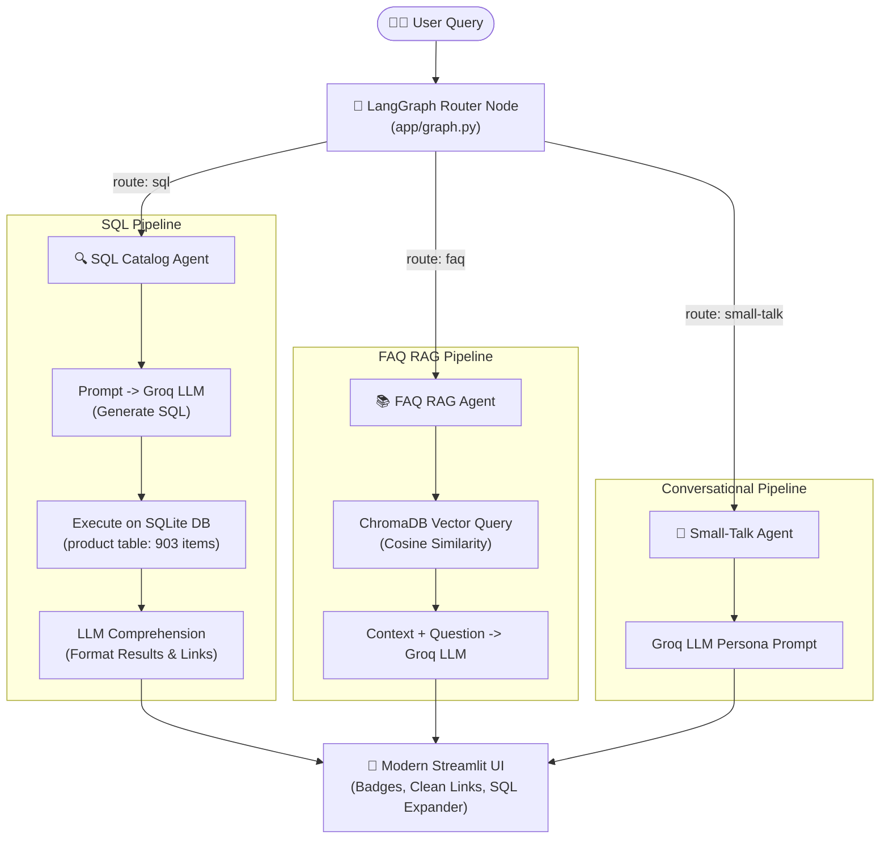
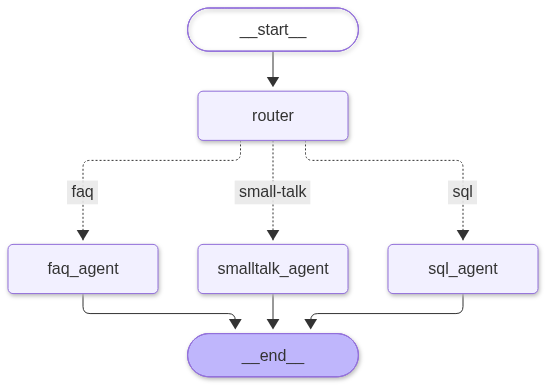

# 🛍️ ShopGenie — Intelligent E-Commerce AI Assistant

[](https://www.python.org/downloads/)
[](https://docs.astral.sh/uv/)
[](https://langchain-ai.github.io/langgraph/)
[](https://streamlit.io)
[](https://groq.com)
[](https://www.trychroma.com)
[](LICENSE)

An intelligent, multi-route conversational AI shopping assistant designed for e-commerce platforms. **ShopGenie** seamlessly navigates between natural language product searches, customer support FAQs, and friendly small-talk by combining **LangGraph StateGraph Routing**, **Text-to-SQL database querying**, and **ChromaDB vector Retrieval-Augmented Generation (RAG)** into a sleek, modern UI.

---

## 📸 User Interface Preview


---

## 🏗️ Architecture & How It Works

The assistant operates on a decoupled multi-agent routing architecture:



### LangGraph Workflow Diagram


---

## ✨ Key Features

- **⚡ LangGraph Intent Routing (`app/graph.py`)**: Stateful `StateGraph` orchestrator using Groq LLM classification with conditional edges and an embedding-similarity fallback to dispatch queries cleanly across specialized agents.
- **🔍 Natural Language to SQL (NL-to-SQL)**: Dynamically translates complex search queries (brands, price caps, discounts, ratings, review volume) into safe SQLite `SELECT` queries on a catalog of 900+ products.
- **📚 FAQ Vector RAG**: Embeds customer care policies into ChromaDB to answer order tracking, returns, refunds, payment options, and international shipping questions with grounded truth.
- **💬 Engaging Small Talk**: Friendly conversational agent providing natural interaction and graceful fallback when queries fall outside predefined catalog intents.
- **🎨 Modern Clean UI**:
  - Hero onboarding card with interactive feature highlights.
  - Route classification badges (`Product Catalog`, `Store Knowledge Base`, `Conversational`).
  - Transparent SQL inspector drawer for debugging and auditing generated database queries.
  - Click-to-ask quick starter prompt chips.
  - Automatic link transformation converting raw URLs into clean `[🔗 View on Store]` buttons.
  - Catalog and knowledge base real-time status counters in the sidebar.

---

## 📂 Project Structure

```plaintext
Ecommerce_chatbot/
├── app/
│   ├── resources/
│   │   ├── ecommerce_data_final.csv    # Raw product catalog dataset (Flipkart)
│   │   ├── faq_data.csv                # E-commerce store FAQs dataset
│   │   ├── graph.png                   # Generated LangGraph workflow diagram
│   │   └── shopgenie-ui.png            # Modern clean UI screenshot
│   ├── .env                            # API keys & model configuration
│   ├── db.sqlite                       # SQLite database (product table)
│   ├── faq.py                          # ChromaDB RAG vector ingestion & QA chain
│   ├── graph.py                        # LangGraph StateGraph router & workflow
│   ├── main.py                         # Streamlit clean UI application
│   ├── smalltalk.py                    # Conversational chatbot chain
│   └── sql.py                          # NL-to-SQL generator & data comprehension
├── .env.example                        # Sample environment variables
├── AGENTS.md                           # Multi-agent system documentation & session log
├── pyproject.toml                      # uv project configuration & dependencies
├── README.md                           # Main project documentation
└── uv.lock                             # Locked uv dependency graph
```

---

## 🛠️ Tech Stack

| Component | Technology | Description |
|---|---|---|
| **Frontend UI** | [Streamlit](https://streamlit.io/) | Interactive web UI with custom modern CSS |
| **LLM Provider** | [Groq Cloud](https://groq.com/) | High-speed inference (`openai/gpt-oss-20b`) |
| **Orchestration & Routing** | [LangGraph](https://langchain-ai.github.io/langgraph/) | Stateful `StateGraph` routing between specialized agents |
| **Package Manager** | [uv](https://docs.astral.sh/uv/) | Fast Python dependency & virtual environment management |
| **Embeddings** | [Sentence Transformers](https://sbert.net/) | `sentence-transformers/all-MiniLM-L6-v2` |
| **Vector DB** | [ChromaDB](https://www.trychroma.com/) | Embedding store for semantic FAQ search |
| **Relational DB** | [SQLite3](https://sqlite.org/) | 903 Flipkart footwear products |
| **Data Processing** | [Pandas](https://pandas.pydata.org/) | Data manipulation and query result formatting |

---

## 🚀 Getting Started

### 1. Prerequisites
- **[uv](https://docs.astral.sh/uv/)** installed on your system.
- **Python 3.10+** (managed automatically by `uv`).
- A **Groq API Key** (get one free at [console.groq.com](https://console.groq.com)).

### 2. Clone the Repository
```bash
git clone <repository-url>
cd Ecommerce_chatbot
```

### 3. Install Dependencies with `uv`
```bash
uv sync
```

### 4. Configure Environment Variables
Create an `.env` file in the `app/` folder (or copy from `.env.example`):
```ini
GROQ_API_KEY=gsk_your_groq_api_key_here
GROQ_MODEL=openai/gpt-oss-20b
```

> **Tip:** You can also use other Groq-supported models such as `llama-3.3-70b-versatile` or `mixtral-8x7b-32768`.

---

## 🖥️ Running the Application

Launch the Streamlit app from the project directory using `uv`:

```bash
uv run streamlit run app/main.py
```

The application will launch in your default browser at:
`http://localhost:8501`

---

## 💡 Example Queries to Try

### 🔍 Product Searches (SQL Agent)
- *"Show me running shoes under Rs. 3000"*
- *"Find top 3 Nike shoes with at least 30% discount"*
- *"What are the highest rated shoes for women?"*
- *"Show me Puma sneakers with rating above 4.2"*

### 📚 Store Policies & FAQs (RAG Agent)
- *"What is your return policy?"*
- *"Do I get a discount with my HDFC credit card?"*
- *"How can I track my order?"*
- *"What payment methods do you accept?"*
- *"How long does it take to process a refund?"*

### 💬 Casual Conversation (Small Talk Agent)
- *"Hello! Who are you?"*
- *"What can you help me with?"*
- *"Tell me a fun shoe fact"*

---

## ⚙️ How Each Module Works

### 1. LangGraph Router (`app/graph.py`)
Defines a compiled `StateGraph` with a `router` node that classifies incoming queries into `sql`, `faq`, or `small-talk` (with an embedding-similarity fallback), then routes via conditional edges to the appropriate agent node (`sql_agent`, `faq_agent`, or `smalltalk_agent`).

### 2. Product SQL Chain (`app/sql.py`)
1. **Query Generation**: Formulates an executable SQLite `SELECT` query given the table schema.
2. **Execution**: Safely executes `SELECT` statements on `db.sqlite`.
3. **Data Comprehension**: Translates raw rows into conversational product recommendations with title, price, discount %, rating, and direct product links.

### 3. FAQ Vector RAG (`app/faq.py`)
1. **Ingestion**: Ingests store FAQ questions and answers into a ChromaDB collection (`faqs`).
2. **Retrieval**: Retrieves top-2 relevant Q&A pairs for the query.
3. **Generation**: Groq LLM synthesizes an accurate, concise answer strictly grounded in the retrieved context.

### 4. Small Talk (`app/smalltalk.py`)
Handles conversational greetings, questions about the chatbot's identity, and general pleasantries.

---

## 🛡️ Rate Limits & Token Guardrails

To prevent Groq TPM (Tokens Per Minute) limit overruns (e.g. HTTP 413 on free tiers):
- **SQL Generation Guardrail**: System prompt mandates an explicit `LIMIT 5` (max 8) on all generated queries.
- **Data Capping**: The Python pipeline enforces `response.head(5)` before feeding rows into data comprehension, preventing large multi-thousand-token prompts.
- **Fail-Safe Fallback**: If an API rate limit or outage occurs, the system automatically builds recommendation lists directly from the database rows without crashing the application.

---

## 📄 License
This project is open-source and available under the [MIT License](LICENSE).
